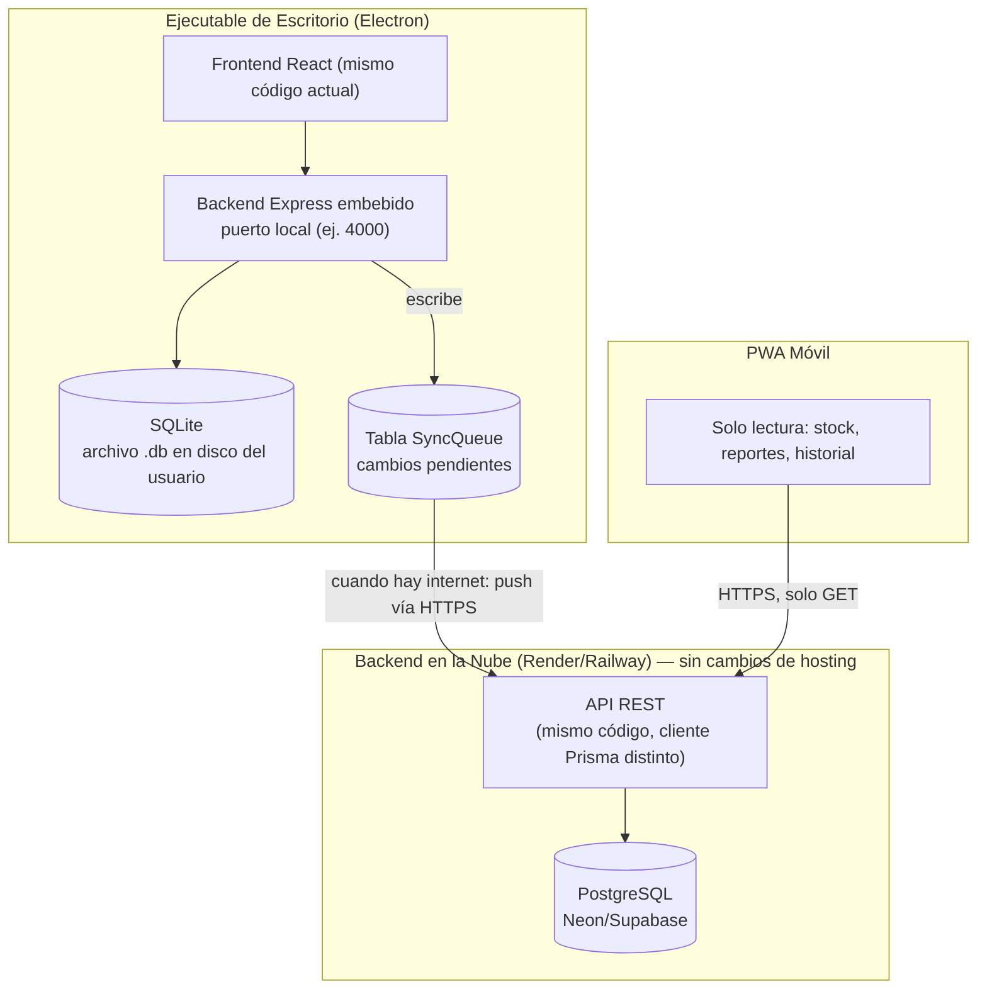

# Instrucciones para Antigravity — Migración a Arquitectura Híbrida (Local-First + Sincronización)
## Proyecto: Sistema Ferretería (FerrePro) — Guasdualito, Estado Apure

> Este es un cambio arquitectónico de fondo, no una iteración de UI. Lee `AGENTS.md`, `documento-maestro-ferreteria.md`, `REPORTE-ESTADO-PROYECTO.md` e `INSTRUCCIONES-ANTIGRAVITY-MULTIMONEDA.md` antes de empezar. **Esta migración debe hacerse ANTES o EN PARALELO con el multimoneda** — ambas tocan `schema.prisma` y conviene planificarlas juntas para no duplicar migraciones.

---

## 0. Decisión arquitectónica y motivo

El cliente necesita un **ejecutable de escritorio** que funcione al 100% sin internet (venta, facturación, inventario), y que además permita consultar stock desde el celular estando fuera del negocio. Esto descarta tanto "solo local" (no cumple lo del celular) como "solo nube" (no cumple vender sin internet — y es la causa raíz del error `ECONNREFUSED` reportado, ya que no había Postgres corriendo localmente).

**Arquitectura elegida: Local-first con sincronización a la nube.**



**Regla de seguridad no negociable:** el ejecutable **nunca** contiene credenciales de PostgreSQL ni se conecta directamente a la base de datos en la nube. Toda comunicación hacia la nube pasa por la API REST vía HTTPS, igual que lo haría el móvil.

**Alcance V1 (dejarlo explícito):** se asume **una sola terminal de venta** (un solo `.exe` corriendo activamente por ferretería). El móvil es solo-lectura. Por lo tanto no hay conflictos de escritura concurrente que resolver en esta fase. Si en el futuro se necesitan múltiples cajas registrando ventas simultáneamente, eso requiere un motor de resolución de conflictos más sofisticado — **queda fuera de alcance de esta iteración, documentarlo como Fase 2.**

---

## 1. Cambios en el modelo de datos

### 1.1 IDs: de autoincremental a UUID

Todas las entidades que se sincronizan (`Producto`, `Categoria`, `Proveedor`, `Cliente`, `Venta`, `DetalleVenta`, `PagoVenta`, `MovimientoInventario`, `Configuracion`) deben cambiar su `id` de `Int @id @default(autoincrement())` a:

```prisma
id String @id @default(uuid())
```

**Motivo:** si el ID se genera localmente en SQLite mientras está offline, y luego otro registro se crea en otro momento, un autoincremental podría colisionar o desordenarse al sincronizar. UUID generado en el cliente evita esto por completo — el ID es el mismo en SQLite y en Postgres, sin necesidad de mapeo.

`Usuario` puede mantenerse con autoincremental si no se sincroniza (los usuarios se gestionan localmente por ahora); evaluar si conviene sincronizarlo también para que el login funcione igual en ambos entornos — **si se sincroniza, aplicar la misma regla de UUID.**

### 1.2 Nueva tabla: `SyncQueue`

```prisma
enum EstadoSync {
  PENDIENTE
  SINCRONIZADO
  ERROR
}

enum OperacionSync {
  CREAR
  ACTUALIZAR
  ELIMINAR
}

model SyncQueue {
  id            String        @id @default(uuid())
  entidad       String        // ej. "Producto", "Venta"
  entidadId     String        // el UUID del registro afectado
  operacion     OperacionSync
  payload       String        // JSON serializado del registro completo
  estado        EstadoSync    @default(PENDIENTE)
  intentos      Int           @default(0)
  ultimoError   String?
  creadoEn      DateTime      @default(now())
  sincronizadoEn DateTime?
}
```

Esta tabla vive **solo en el schema de SQLite** (el local) — no existe en el schema de Postgres, ya que la nube es el destino, no el origen, de la sincronización.

---

## 2. Dos schemas de Prisma independientes

Prisma no permite cambiar el `provider` dinámicamente en un mismo schema. Por lo tanto:

```
/prisma
  schema.local.prisma     -> provider = "sqlite"   (usado por apps/api cuando corre embebido en Electron)
  schema.cloud.prisma     -> provider = "postgresql" (usado por el backend desplegado en Render/Railway)
```

- Ambos comparten la misma estructura lógica de modelos (excepto `SyncQueue`, que solo existe en el local).
- Generar cada cliente a un output distinto:
  ```prisma
  generator client {
    provider = "prisma-client-js"
    output   = "../node_modules/.prisma/client-local"   // o client-cloud
  }
  ```
- El código del backend (`apps/api/src`) debe poder importar el cliente correcto según una variable de entorno `RUNTIME_MODE=local|cloud`, definida en un archivo `db.ts` centralizado:
  ```ts
  export const prisma = process.env.RUNTIME_MODE === "cloud"
    ? require("./generated/client-cloud").prisma
    : require("./generated/client-local").prisma;
  ```
- **Mostrar el diff de ambos schemas antes de aplicar cualquier migración**, por regla de `AGENTS.md` sección 7.

---

## 3. Backend local embebido en Electron

- El backend Express (`apps/api`) debe poder arrancar como **proceso hijo** del proceso principal de Electron, escuchando en un puerto local fijo (ej. `4000`) o dinámico si hay conflicto de puertos.
- La base de datos SQLite se almacena en `app.getPath('userData')/ferreteria.db` (ruta estándar de Electron para datos de usuario) — **no** dentro de la carpeta de instalación, para que sobreviva actualizaciones de la app y no requiera permisos de administrador para escribir.
- Al primer arranque, si no existe el archivo `.db`, ejecutar automáticamente `prisma migrate deploy` contra el schema local para crear las tablas — el usuario final no debe ejecutar comandos manualmente.
- El frontend (React) sigue haciendo `fetch` a `http://localhost:4000/api/...` exactamente igual que ahora — **no cambia la lógica de los componentes**, solo cambia qué hay detrás del backend.

---

## 4. Motor de sincronización (patrón Outbox)

- **Trigger de escritura:** cada vez que el backend local hace un `create`/`update`/`delete` en una entidad sincronizable, además de escribir en SQLite, inserta una fila en `SyncQueue` con el payload completo del registro.
- **Worker de sincronización:** un proceso en segundo plano dentro de Electron (o un `setInterval` en el backend embebido) que cada N segundos (ej. 15s):
  1. Verifica conectividad real (no solo `navigator.onLine`, que no es confiable) — hacer un `GET` corto con timeout a un endpoint `/api/health` de la nube.
  2. Si hay conexión, toma las filas `PENDIENTE` de `SyncQueue` en orden de creación y las envía una por una (o en lote) a un endpoint nuevo:
     ```
     POST /api/sync/push
     Body: { entidad, entidadId, operacion, payload }
     ```
  3. El backend en la nube aplica el cambio de forma **idempotente** (usa `upsert` por `id`, nunca `create` puro, para que reintentos no dupliquen registros).
  4. Si la respuesta es exitosa, marca la fila local como `SINCRONIZADO`. Si falla, incrementa `intentos` y guarda `ultimoError`; tras 5 intentos fallidos, marca como `ERROR` y deja de reintentar automáticamente (requiere revisión manual).
- **Orden de sincronización:** respetar el orden cronológico de creación de la cola — no sincronizar una `Venta` antes que el `Producto` que referencia, si ambos están pendientes.

---

## 5. Endpoint nuevo en la API de la nube

```
POST /api/sync/push       -> recibe cambios desde el ejecutable, protegido con API key de servicio (no JWT de usuario)
GET  /api/health          -> healthcheck simple, usado por el worker para detectar conectividad
```

La autenticación de `/api/sync/push` debe ser un **API key fijo por instalación** (no las credenciales del cajero), generado una vez y guardado en la configuración local del `.exe` — así, aunque el cajero cierre sesión, la sincronización de fondo sigue funcionando.

---

## 6. Empaquetado del ejecutable (Electron)

- Usar **`electron-builder`** para generar el instalador `.exe` de Windows (formato NSIS, con ícono de la marca FerrePro).
- El build de producción del frontend (`apps/web`, ya configurado con Vite) se empaqueta como archivos estáticos servidos localmente por Electron o por el propio backend Express embebido.
- Variables de entorno necesarias en el ejecutable:
  - `RUNTIME_MODE=local`
  - `DATABASE_URL="file:./ferreteria.db"` (relativa a `userData`)
  - `CLOUD_API_URL="https://<tu-backend-en-render>.onrender.com"`
  - `SYNC_API_KEY="<generado en la instalación>"`
- **No incluir en el build ningún `DATABASE_URL` de PostgreSQL ni credenciales de Neon/Supabase** — esas solo existen en el entorno de despliegue del backend en la nube.

---

## 7. Panel de Estado de Sincronización (nuevo, en el módulo de Gestión)

Agregar una pestaña o sección visible (puede ir en `ConfiguracionView.tsx`, como panel adicional, sin tocar las 4 pestañas ya existentes):

- Indicador visual: 🟢 "Sincronizado" / 🟡 "Pendientes: N cambios" / 🔴 "Sin conexión — trabajando localmente".
- Fecha/hora de la última sincronización exitosa.
- Botón "Reintentar sincronización ahora" (fuerza al worker a intentar de inmediato en vez de esperar el intervalo).
- Si hay filas en estado `ERROR`, mostrarlas en una lista simple para que el ADMIN pueda ver qué no se sincronizó y por qué (mensaje de `ultimoError`).

---

## 8. Impacto sobre el módulo multimoneda (coordinar con `INSTRUCCIONES-ANTIGRAVITY-MULTIMONEDA.md`)

- `Configuracion` (que incluye las tasas de cambio) también se sincroniza mediante este mismo mecanismo de `SyncQueue`. Se edita en el `.exe` (por el ADMIN), se sincroniza a la nube, y el móvil la lee de ahí — coherente con que el móvil es solo-lectura.
- El campo `tasaAplicada` de `PagoVenta` sigue congelándose localmente en el momento de la venta, tal como se definió — eso no cambia con la sincronización, solo se replica tal cual hacia la nube.

---

## 9. Plan de migración (orden sugerido)

1. Crear `schema.local.prisma` (SQLite) y `schema.cloud.prisma` (PostgreSQL) a partir del schema único actual, con los cambios de UUID. Mostrar diff antes de migrar.
2. Adaptar `apps/api` para soportar el cliente Prisma según `RUNTIME_MODE`.
3. Implementar `SyncQueue` y el worker de sincronización (sin Electron todavía — probarlo corriendo el backend local normal contra SQLite y la nube en dos terminales).
4. Implementar `/api/sync/push` y `/api/health` en el backend de la nube.
5. Envolver todo con Electron + `electron-builder`, apuntando a SQLite local.
6. Agregar el panel de Estado de Sincronización en Gestión.
7. Probar escenario completo: vender offline → reconectar → verificar que la venta aparece en la nube y es visible desde la PWA móvil.
8. Solo después de validar esto, continuar con la implementación del multimoneda sobre esta nueva base.

---

## 10. Tests requeridos

- Crear una `Venta` con `RUNTIME_MODE=local` sin conexión a la nube (mockear `/api/health` como caído) → debe guardarse en SQLite y quedar en `SyncQueue` como `PENDIENTE`, sin error visible al usuario.
- Simular reconexión → el worker debe sincronizar automáticamente y marcar como `SINCRONIZADO`.
- Reintento con fallo simulado 5 veces consecutivas → la fila pasa a `ERROR` y deja de reintentar solo.
- Sincronización aplicada dos veces con el mismo payload (idempotencia) → no debe duplicar el registro en Postgres (validar con `upsert`).

---

## 11. Definición de "hecho"

- El `.exe` instala y corre sin requerir Postgres, Docker, ni conexión a internet.
- Las ventas, productos y demás operaciones funcionan 100% local, sin lag perceptible.
- Al recuperar internet, los cambios pendientes se sincronizan automáticamente a la nube sin intervención manual.
- La PWA móvil sigue mostrando la misma información (con el retraso propio de la sincronización) sin que el usuario del celular pueda escribir datos.
- El panel de Estado de Sincronización refleja con precisión pendientes, errores y última sincronización exitosa.
