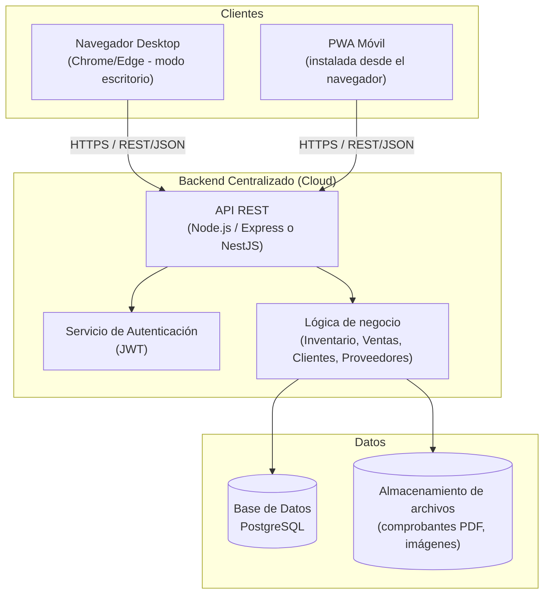
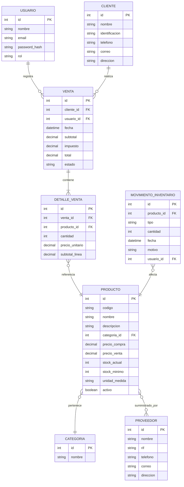
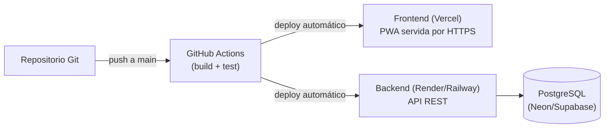

# Documento Maestro
## Sistema de Gestión de Ventas e Inventario — Ferretería
### Análisis, Diseño, Arquitectura y Plan de Desarrollo

---

## 0. Resumen Ejecutivo

Este documento define el análisis, diseño técnico y plan de implementación de un **sistema de gestión integral** para una ferretería, que cubre:

- Gestión de inventario y productos
- Gestión de proveedores y clientes
- Facturación / punto de venta (POS)
- Acceso multiplataforma: **aplicación de escritorio** + **aplicación móvil tipo PWA** (Progressive Web App), con datos sincronizados en tiempo real desde una única fuente de verdad (backend centralizado en la nube).

La estrategia elegida evita depender de tiendas de aplicaciones (App Store / Play Store) mediante una **PWA instalable**, que se comporta como app nativa (ícono, pantalla completa, funciona offline parcialmente) pero es, en esencia, una aplicación web servida por navegador. Esto resuelve la restricción de no contar con cuenta de desarrollador Apple/Google y reduce drásticamente el costo y tiempo de desarrollo, manteniendo una sola base de código.

---

## 1. Objetivos del Sistema

### 1.1 Objetivo General
Desarrollar un sistema web centralizado que permita administrar el inventario, las ventas y la información comercial de una ferretería, accesible desde computadora (modo escritorio/navegador) y desde dispositivos móviles (PWA instalable), con información sincronizada en tiempo real.

### 1.2 Objetivos Específicos
- Gestionar el ciclo de vida completo de productos (alta, edición, baja, consulta de stock).
- Administrar proveedores y el histórico de compras/reposición.
- Administrar clientes (incluyendo crédito/cuentas por cobrar si aplica).
- Emitir facturas de venta con control automático de descuento de inventario.
- Ofrecer consulta de stock en tiempo real desde cualquier dispositivo con internet.
- Generar reportes básicos de ventas, productos más vendidos y niveles de stock crítico.
- Controlar accesos por rol de usuario (administrador, cajero, encargado de inventario).

---

## 2. Alcance del Proyecto

### Incluye (V1)
- Módulo de Inventario (productos, categorías, stock, alertas de stock mínimo)
- Módulo de Proveedores
- Módulo de Clientes
- Módulo de Facturación / Ventas (POS simplificado)
- Módulo de Usuarios y Roles (autenticación y autorización)
- Dashboard con indicadores clave
- PWA instalable en Android/iOS/Desktop vía navegador
- Sincronización en tiempo real vía backend único (no hay "dos sistemas", hay una sola API consumida por dos interfaces)

### No incluye (fuera de alcance V1, propuesto como Fase 2)
- Facturación fiscal electrónica certificada ante ente gubernamental (SENIAT u otro), salvo que el cliente lo requiera explícitamente — esto se trata aparte porque implica integración legal/fiscal.
- Aplicaciones nativas publicadas en App Store / Play Store.
- Módulo contable completo (libros contables, balances).
- Multi-sucursal (se puede dejar preparado en el modelo de datos, pero no se implementa la lógica completa en V1).

---

## 3. Actores del Sistema

| Rol | Descripción | Permisos clave |
|---|---|---|
| **Administrador** | Dueño o gerente de la ferretería | Acceso total: productos, usuarios, reportes, configuración |
| **Cajero / Vendedor** | Atiende el punto de venta | Crear facturas, consultar stock y clientes |
| **Encargado de Inventario** | Gestiona productos y proveedores | CRUD de productos, proveedores, ajustes de stock |
| **Cliente (opcional, Fase 2)** | Consulta de disponibilidad de productos | Solo lectura de catálogo público |

---

## 4. Requisitos

### 4.1 Requisitos Funcionales (RF)

**Inventario**
- RF01: El sistema debe permitir crear, editar, eliminar (baja lógica) y consultar productos.
- RF02: Cada producto debe tener código, nombre, descripción, categoría, unidad de medida, precio de compra, precio de venta, stock actual, stock mínimo.
- RF03: El sistema debe alertar cuando un producto llegue a su stock mínimo.
- RF04: El sistema debe registrar movimientos de inventario (entradas por compra, salidas por venta, ajustes manuales).

**Proveedores**
- RF05: CRUD de proveedores (nombre, RIF/ID fiscal, teléfono, correo, dirección).
- RF06: Asociar productos a uno o varios proveedores.
- RF07: Registrar órdenes de compra/reposición a proveedores (Fase 2 puede incluir seguimiento de estado).

**Clientes**
- RF08: CRUD de clientes (nombre, identificación, teléfono, correo, dirección).
- RF09: Histórico de compras por cliente.

**Facturación / Ventas**
- RF10: Crear una venta seleccionando productos, cantidades, calculando subtotal, impuestos y total.
- RF11: Al confirmar la venta, descontar automáticamente del stock.
- RF12: Generar comprobante de venta (PDF o vista imprimible).
- RF13: Consultar histórico de ventas con filtros (fecha, cliente, vendedor).
- RF14: Permitir anular una venta con reversión de stock (con auditoría de quién y cuándo).

**Usuarios**
- RF15: Login con usuario/contraseña.
- RF16: Gestión de roles y permisos.

**Multiplataforma**
- RF17: Toda la información debe reflejarse en tiempo real (o casi real) entre el acceso de escritorio y el acceso móvil, dado que ambos consumen la misma API/base de datos.
- RF18: La aplicación debe poder instalarse desde el navegador móvil como ícono en la pantalla de inicio (PWA).

### 4.2 Requisitos No Funcionales (RNF)

| Código | Requisito |
|---|---|
| RNF01 | Disponibilidad: el backend debe estar accesible vía internet 24/7 (hosting en la nube). |
| RNF02 | Seguridad: contraseñas hasheadas (bcrypt/argon2), comunicación vía HTTPS, tokens JWT con expiración. |
| RNF03 | Escalabilidad: arquitectura preparada para crecer a más usuarios/sucursales sin reescritura total. |
| RNF04 | Usabilidad: interfaz responsiva, adaptada a pantallas de escritorio y móvil. |
| RNF05 | Rendimiento: respuestas de API menores a 500ms en operaciones estándar. |
| RNF06 | Mantenibilidad: código modular, documentado, con control de versiones (Git). |
| RNF07 | Compatibilidad: funcional en navegadores modernos (Chrome, Edge, Safari, Firefox) tanto en desktop como mobile. |

---

## 5. Arquitectura General del Sistema

La arquitectura propuesta es **cliente-servidor con API REST centralizada**, un solo backend y una sola base de datos, consumidos por dos "clientes": la interfaz de escritorio (navegador de PC) y la PWA (navegador móvil). No son dos sistemas separados — es **una sola aplicación web responsiva** que se adapta al dispositivo, más una capa de configuración PWA para que sea instalable en el teléfono.



**Idea clave:** una sola fuente de verdad (la base de datos en la nube). El "escritorio" y el "móvil" no son dos sistemas que se sincronizan entre sí — ambos son ventanas distintas hacia el mismo backend. Esto elimina problemas de sincronización manual y conflictos de datos.

---

## 6. Stack Tecnológico Recomendado

| Capa | Tecnología sugerida | Justificación |
|---|---|---|
| Frontend (Web + PWA) | **React** + **Vite** + **TailwindCSS** | Una sola base de código responsiva; Vite facilita configurar PWA con `vite-plugin-pwa`. |
| Gestión de estado / datos remotos | **React Query (TanStack Query)** | Manejo de sincronización, caché y estados de carga/error contra la API. |
| Backend / API | **Node.js + Express** (o NestJS si se quiere más estructura tipo enterprise) | JavaScript/TypeScript en todo el stack = una sola comunidad de conocimiento. |
| Base de datos | **PostgreSQL** | Relacional, robusta, ideal para inventario/facturación con integridad referencial. |
| ORM | **Prisma** | Migraciones claras, tipado fuerte, productividad alta. |
| Autenticación | **JWT + bcrypt** | Estándar, stateless, funciona bien para múltiples dispositivos. |
| Generación de PDF (facturas) | **Puppeteer** o **pdf-lib** en backend | Comprobantes descargables/imprimibles. |
| Hosting Backend | **Railway / Render / Fly.io** (nivel inicial) → **AWS/GCP** (a futuro) | Despliegue rápido y económico para empezar. |
| Hosting Frontend | **Vercel / Netlify** | Despliegue continuo desde Git, HTTPS automático, ideal para PWA. |
| Base de datos gestionada | **Neon / Supabase / RDS** | PostgreSQL administrado, backups automáticos. |
| Control de versiones | **Git + GitHub** | Trabajo colaborativo y control de cambios. |
| CI/CD | **GitHub Actions** | Automatizar pruebas y despliegue. |

> Nota técnica: al usar **React + Vite con PWA plugin**, obtienes automáticamente el `manifest.json` y el `service worker` necesarios para que el navegador móvil ofrezca "Agregar a pantalla de inicio", cumpliendo exactamente lo que describiste: un ícono que abre lo que en el fondo es el navegador, pero se siente como app nativa.

---

## 7. Modelo de Datos (Entidad-Relación)



---

## 8. Diseño de la API REST (endpoints principales)

```
Autenticación
POST   /api/auth/login
POST   /api/auth/refresh

Productos
GET    /api/productos
GET    /api/productos/:id
POST   /api/productos
PUT    /api/productos/:id
DELETE /api/productos/:id
GET    /api/productos/alertas-stock

Categorías
GET    /api/categorias
POST   /api/categorias

Proveedores
GET    /api/proveedores
POST   /api/proveedores
PUT    /api/proveedores/:id
DELETE /api/proveedores/:id

Clientes
GET    /api/clientes
POST   /api/clientes
PUT    /api/clientes/:id
DELETE /api/clientes/:id

Ventas / Facturación
GET    /api/ventas
GET    /api/ventas/:id
POST   /api/ventas
POST   /api/ventas/:id/anular
GET    /api/ventas/:id/pdf

Reportes / Dashboard
GET    /api/reportes/ventas-diarias
GET    /api/reportes/productos-mas-vendidos
GET    /api/reportes/stock-critico

Usuarios
GET    /api/usuarios
POST   /api/usuarios
PUT    /api/usuarios/:id
```

Todas las respuestas en formato JSON, protegidas con middleware de autenticación (excepto `/auth/login`), y con validación de rol para operaciones sensibles (eliminar, anular ventas, gestionar usuarios).

---

## 9. Estrategia PWA (la "app móvil sin tienda de apps")

1. **Manifest** (`manifest.json`): define nombre, ícono, color de tema y `display: standalone` para que al abrirse no se vea la barra del navegador — se siente como app.
2. **Service Worker**: cachea los assets estáticos (HTML/CSS/JS) para carga rápida y permite mostrar una pantalla básica aunque no haya conexión momentánea; las operaciones de datos (ventas, stock) requieren conexión, ya que deben ir contra la API en tiempo real (se puede evaluar cola offline en Fase 2 con IndexedDB + sincronización diferida).
3. **Instalación**: en Android/Chrome aparece el prompt "Agregar a pantalla de inicio" automáticamente; en iOS/Safari se hace manualmente vía "Compartir → Agregar a inicio", igual queda con ícono propio.
4. **Responsive design**: un solo set de componentes React con Tailwind, usando breakpoints para adaptar tablas de escritorio a tarjetas/listas en móvil.

---

## 10. Seguridad

- Contraseñas nunca en texto plano — hash con **bcrypt**.
- Autenticación **JWT** con expiración corta + refresh token.
- Control de acceso por rol (RBAC) en cada endpoint sensible.
- HTTPS obligatorio en producción (lo da automáticamente Vercel/Render).
- Rate limiting básico en endpoints de login para evitar fuerza bruta.
- Logs de auditoría en operaciones críticas (anulación de ventas, eliminación de productos).

---

## 11. Plan de Desarrollo por Fases

| Fase | Duración estimada | Entregable |
|---|---|---|
| **Fase 0 — Setup** | 1 semana | Repositorio, entorno de desarrollo, estructura del monorepo, CI básico |
| **Fase 1 — Backend base** | 2 semanas | Modelo de datos, autenticación, CRUD de Productos/Categorías/Proveedores/Clientes |
| **Fase 2 — Frontend base (Web/PWA)** | 2 semanas | Login, dashboard, listados y formularios CRUD conectados a la API |
| **Fase 3 — Módulo de Facturación** | 2 semanas | Flujo de venta completo, descuento de stock, generación de PDF |
| **Fase 4 — PWA + Responsive** | 1 semana | Manifest, service worker, ajustes de UI para móvil, pruebas de instalación |
| **Fase 5 — Reportes y Dashboard** | 1 semana | Indicadores clave, alertas de stock, reportes de ventas |
| **Fase 6 — QA y Ajustes** | 1 semana | Pruebas funcionales, corrección de bugs, revisión de UX |
| **Fase 7 — Despliegue (Deploy)** | 3-4 días | Backend en Render/Railway, DB en Neon/Supabase, Frontend en Vercel, dominio propio |

**Estimado total:** ~10-11 semanas para una V1 sólida trabajando de forma dedicada (ajustable según disponibilidad de tiempo).

---

## 12. Estrategia de Despliegue (Deploy)



- **Dominio propio**: se recomienda comprar un dominio (ej. `ferreteriaXYZ.com`) para que el link de instalación de la PWA se vea profesional.
- **Backups automáticos** de la base de datos (los proveedores gestionados los incluyen por defecto).
- **Variables de entorno** separadas por ambiente (desarrollo/producción) para credenciales y llaves.
- **Monitoreo básico**: logs del proveedor de hosting + alertas de caída (ej. UptimeRobot gratuito).

---

## 13. Consideraciones de Escalabilidad Futura

- El modelo de datos ya deja espacio para **multi-sucursal** (agregar `sucursal_id` a Producto, Venta e Inventario cuando se necesite).
- Se puede migrar de PDF simple a **facturación fiscal electrónica** si el marco legal lo exige, como módulo independiente que no rompe el core.
- Preparado para agregar app nativa real en el futuro (React Native podría reutilizar buena parte de la lógica si algún día se decide publicar en tiendas).
- Se puede incorporar **modo offline avanzado** en el POS (cola de ventas en IndexedDB que sincroniza al recuperar conexión) si la ferretería tiene zonas con mala señal.

---

## 14. Resumen de Decisiones Clave

| Decisión | Por qué |
|---|---|
| Un solo backend/API para ambas interfaces | Evita duplicar lógica y problemas de sincronización manual |
| PWA en lugar de apps nativas | No requiere cuentas de desarrollador Apple/Google, un solo código, instalación directa desde navegador |
| PostgreSQL | Integridad de datos crítica para inventario y facturación |
| React + Tailwind | Una sola UI responsiva sirve para desktop y móvil |
| JWT + roles | Seguridad y control de accesos por tipo de usuario |

---

*Documento vivo: se recomienda actualizarlo a medida que el proyecto avance, especialmente el modelo de datos y el plan de fases conforme se validen tiempos reales.*
